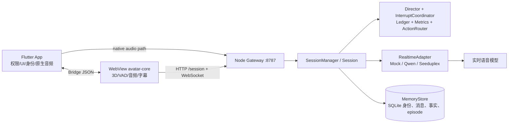

# Avatar Voice POC：新人接手与维护指南

> 更新时间：2026-10-21。本文只描述当前代码和已批准设计，不把未完成的计划写成现状。详细协议以 `docs/superpowers/specs/` 和 `protocol/src/index.ts` 为准。

## 先建立三个判断

1. **网关是对话编排中心**：客户端负责采集、播放、3D 表现和 UI；模型、上下文、主动说话、打断、动作和指标都在 `gateway`。
2. **模型必须通过适配器接入**：会话只依赖 `RealtimeAdapter`，因此没有 Key 时仍用 `MockAdapter` 完成开发和测试。
3. **当前交付状态不是“已上线产品”**：自动化测试和本地链路较完整；小米真机的正式逐项验收、云端 WSS、跨会话记忆仍有开放项，先看 `docs/project/roadmap.md` 和 `docs/blockers.md`。

## 1. 总体架构



一次对话的关键顺序是：

1. App 启动并校验 `--dart-define`；启用身份时先注册设备或读取 `deviceToken`。
2. `AvatarPage` 启动回环 `LocalAssetServer`，WebView 只加载带随机 token 的本地资源；随后通过 Bridge 发送网关地址、密钥和音频路径。
3. 客户端 `GatewayClient` 调 `POST /session`，再用一次性 `connectToken` 建立 `/ws`。首条 `session.start` 触发网关创建模型会话和主动问候。
4. 麦克风上行为 PCM16/16 kHz；AI 下行为 PCM16/24 kHz。二进制帧是 **1 字节类型 + 4 字节大端 `responseSeq` + PCM**，JSON 帧承载状态、字幕、动作、指标和错误。
5. 网关把模型事件统一成协议事件：`response.start` → 音频/字幕增量 → `response.end` 或 `response.cancelled`。客户端只接受当前 `responseSeq`，迟到音频和字幕直接丢弃。
6. 用户插话时客户端先清空播放队列并发送 `playback.stopped(interrupted)`；网关取消模型回复、更新账本的已播放部分，并阻止旧回复继续影响新一轮。
7. 短断线先 `POST /session/resume` 恢复；超过会话保留窗口则创建新会话。网关关闭时先结束会话，再关闭数据库。

### 分层边界

| 层 | 唯一职责 | 入口 |
|---|---|---|
| `protocol` | 共享消息、音频帧、采样率和动作名 | `protocol/src/index.ts` |
| `gateway/server` | HTTP、鉴权、限流、WS、边界校验 | `gateway/src/server/server.ts` |
| `gateway/session` | 会话状态机、主动性、打断、账本、指标 | `gateway/src/session/` |
| `gateway/adapters` | 把各模型协议映射为 `RealtimeAdapter` | `gateway/src/adapters/` |
| `gateway/roles`、`config` | 人设、风格、话术、节奏和预算 | `gateway/roles/`、`gateway/config/` |
| `gateway/memory`、`identity` | SQLite 身份与后续持久记忆 | `gateway/src/memory/`、`gateway/src/identity/` |
| `avatar-core` | WebView 3D、VAD、播放门控、口型、动作、字幕 | `avatar-core/src/` |
| `app` | Android 生命周期、权限、身份、原生音频、WebView 宿主 | `app/lib/` |

## 2. 模型选择、场景与成本

| 模式 | 实现 | 使用场景 | 成本/凭据 |
|---|---|---|---|
| Mock 实时模型 | `MockAdapter` + `gateway/mock/` | 默认开发、自动化测试、无 Key 的真机联调；可回放 PCM 和脚本 | 无模型费用；`ADAPTER=mock` |
| Qwen 实时模型 | `QwenAdapter` | 当前主要真实模型路径；服务端 VAD、流式音频、工具调用、主动回复 | 按供应商实时音频/文本用量计费；需要 `DASHSCOPE_API_KEY` 和 `QWEN_ENDPOINT` |
| 豆包 Seeduplex | `SeeduplexAdapter` | 备用真实实时路径和协议验证 | 按供应商实时服务用量计费；需要 `SEEDUPLEX_API_KEY` |
| Qwen 文本摘要 | `QwenSummarizer` | 账本超预算后的滚动摘要（Plan 3 记忆能力） | 按文本输入/输出计费；默认仍是 `MockSummarizer` |

仓库没有冻结供应商单价或预算，不能从代码推导金额。维护时用“请求次数 × 输入/输出 token 或音频时长 × 供应商单价”估算，并把模型、端点、音色和上限放环境变量/配置，不写进会话流程。模型 Key 只进网关环境变量；App 只拿 `APP_SECRET`，绝不拿模型 Key。

适配器工厂在 `gateway/src/index.ts`：

```text
ADAPTER=mock       -> MockAdapter
ADAPTER=qwen       -> QwenAdapter
ADAPTER=seeduplex  -> SeeduplexAdapter
SUMMARIZER=mock|qwen -> MockSummarizer|QwenSummarizer
```

模型差异必须留在适配器内。`Session` 只能依赖 `connect/sendAudio/updateInstructions/createResponse/cancelResponse/sendToolResult` 等统一接口；新增模型先补适配器和 fixture 测试，再改工厂，不要在 `Session` 里增加模型分支。

## 3. 关键代码目录

### 网关：先读这些文件

- `gateway/src/index.ts`：启动顺序、配置加载、角色目录、数据库、适配器工厂、优雅关闭。
- `gateway/src/server/server.ts`、`schemas.ts`：HTTP/WS 路由、鉴权、限流、帧校验。
- `gateway/src/session/session.ts`：单会话主状态机；看 `start`、`handleMicAudio`、`handleClientMessage`、`cancel`、`rebuild`。
- `gateway/src/session/manager.ts`：会话 token、claim/resume、断线宽限和会话上限。
- `gateway/src/session/director.ts`：问候、沉默阶梯、主动追问和误打断兜底。
- `gateway/src/session/interrupt.ts`：本地 VAD 与模型 VAD 的确认窗口、取消和误打断计数。
- `gateway/src/session/ledger.ts`：会话内上下文、摘要接口和重建前的指令预算。
- `gateway/src/roles/fileCatalog.ts`：加载 `role.json`、风格 Markdown、活动卡和 `director.json`；启动时 zod 校验。
- `gateway/src/memory/store.ts`、`identity/registry.ts`：SQLite 身份绑定、消息转写、事实与 episode 存储。Plan 3 记忆 MVP 已合并；手机端话题接续、假设 8 真机工具轮等验收仍按 `docs/project/roadmap.md` 推进。

### 客户端：按运行模式选择路径

- `app/lib/avatar_page.dart`：权限、WebView、Bridge、Native Session 启动和 UI 状态。
- `app/lib/native_gateway/gateway_client.dart`：Dart 原生音频路径的 HTTP/WS、重连和 token。
- `app/lib/native_session/`：原生音频路径的响应序列、思考态、垫话和事件转发。
- `app/lib/native_audio/`：`record` 采集、PCM 播放队列、能量 VAD、打断清空。
- `app/lib/local_asset_server.dart`：回环 HTTP 静态资源服务；不要改成文件 URL 或开放网卡监听。
- `avatar-core/src/app.ts`：WebView 路径总控；串起采集、VAD、播放、GatewayClient、字幕和状态机。
- `avatar-core/src/net/gatewayClient.ts`：WebView 路径的网关连接和重连。
- `avatar-core/src/audio/`：麦克风、AudioWorklet、播放门控、口型分析和 VAD。
- `avatar-core/src/avatar/`：TalkingHead、状态机、动作、表情和字幕驱动口型。

### 配置和资源

- `gateway/.env.example`：环境变量模板；实际 `.env` 不提交。
- `gateway/config/{pacing,memory,emotion}.json`：预算、节奏、情绪词表。
- `gateway/roles/elder-companion/`：当前角色、`grandchild`/`old-friend` 风格、主动话术和活动。
- `app/assets/config/thinking.json`：客户端思考态和垫话开关；当前 `fillersEnabled=false`，占位音色未解决前不要打开。
- `scripts/build-web.sh`、`scripts/fetch-assets.sh`：构建 WebView bundle 和获取头像/动画资源。
- 用 Avaturn 自建 GLB 替换形象：见 [虚拟形象替换指南](./avatar-replacement-guide.md)。

## 4. 新人上手路径

1. 先读本文、`docs/project/roadmap.md`、`docs/blockers.md`，再读对应计划；不要以旧 checkbox 推断完成状态。
2. 安装依赖并准备本地配置：

   ```bash
   npm ci
   cp gateway/.env.example gateway/.env
   # 在本机填入随机 APP_SECRET；无 Key 保持 ADAPTER=mock
   (cd app && flutter pub get)
   ```

3. 先跑静态验证：

   ```bash
   npm test
   npm run typecheck
   cd app && flutter test && flutter analyze
   ```

4. Mock 联调：启动 `npm run dev -w gateway`，需要 WebView 时先运行 `./scripts/build-web.sh`，再用 `flutter run --dart-define-from-file=dev.json`。桌面调试可单独运行 `npm run dev -w avatar-core`，但它不代表 Android 验收。
5. 改动前先找现有测试：`gateway/test/session.test.ts`、`director.test.ts`、`interrupt.test.ts`、`seeduplex.test.ts`、`qwen.test.ts`；客户端看对应 `avatar-core/test/` 和 `app/test/`。核心逻辑按“先失败测试、再实现、再完整回归”推进。

## 5. 维护时最容易破坏的约束

- 不记录音频、ASR、回复文本；日志只能有事件名、ID、计数、时长和错误码。
- 不要在 `Session` 中硬编码话术、阈值、模型名或音色；改 `gateway/config`、`gateway/roles` 或 App 配置。
- 不要恢复“播放期间完全不上传麦克风”的旧逻辑：Qwen 服务端 VAD 负责判轮，本地确认后仍需上传插话开头。
- `responseSeq` 是客户端零残留的核心边界；取消后旧序列的音频、字幕、工具调用都必须丢弃。
- Director 的指令会进入模型上下文，不能把可照读的示例句、助手上一句或“被用户打断”写进去。
- `MEMORY_DB_PATH` 必须是仓库外绝对路径；没有它就是开发模式，不读写持久记忆。
- 不提交 `.env*`、`app/dev.json`、模型 Key 或下载的私有头像资源；不使用 `git add -A` 覆盖他人未提交修改。

## Truth Source

| Contract | 唯一来源 | 维护要点 |
|---|---|---|
| WS/二进制协议 | `protocol/src/index.ts` | 改字段先同步所有客户端和测试 |
| HTTP/WS 边界校验 | `gateway/src/server/schemas.ts` | 只在边界用 zod，内部不重复发明语义 |
| 会话生命周期 | `SessionManager` + `Session` | token、断线宽限、取消和重建由网关拥有 |
| 角色与话术 | `gateway/roles/**` | 角色文件启动时校验，代码只消费配置 |
| 身份与持久资源 | `MemoryStore` | owner/agent 作用域查询，删除走级联 |
| 客户端展示与播放 | `avatar-core` 或 `app/native_session` | 以 `responseSeq` 和播放进度为准 |

| 资源 | 创建者 | 生命周期拥有者 | 消费者 |
|---|---|---|---|
| `Session` | `SessionManager` | `gateway` | WS transport、adapter、identity |
| `responseSeq` 回复 | `Session` | `Session` 直到 end/cancel | 播放器、字幕、Ledger |
| 设备/主人/智能体 | `DeviceRegistry`/`MemoryStore` | `identity`/`memory` | `/session`、App |
| 3D/Web 资源 | 构建脚本 | App 本地服务器 | WebView |

| 资源 | 初始状态 | 合法转换 | 终态/回滚 |
|---|---|---|---|
| `Session` | `created` | `claim → connected → resumed/disconnected → ended` | `ended`；宽限期内可 resume，过期创建新会话 |
| 回复序列 | 未激活 | `start → streaming → end/cancel` | `end` 或 `cancel`；取消序列的迟到事件丢弃 |
| 设备身份 | 未注册 | `register → bound → style changed` | 删除主人级联设备、智能体、会话 |

| 验收项 | 命令/证据 | 结果 |
|---|---|---|
| 协议与网关单测 | `npm test` | protocol、gateway、avatar-core 测试通过 |
| TypeScript 契约 | `npm run typecheck` | 三个 npm workspace 无类型错误 |
| Flutter 客户端 | `cd app && flutter test && flutter analyze` | Dart 测试通过且无 analyzer 错误 |
| Mock 本地链路 | 网关 `ADAPTER=mock` + `./scripts/build-web.sh` + Flutter 启动 | 可验证会话、字幕、音频、动作和重连；真机逐项仍看 roadmap |
| 真实模型 | `docs/research/*-validation.md` 中的受控 smoke | 仅在对应记录存在时宣称验证；不能用 Mock 结果替代 |

## Integration Execution Contract

| 场景 | 组件与启动顺序 | 模式/路由 | 验证 |
|---|---|---|---|
| `MOCK-LOCAL` | `npm run dev -w gateway` → `./scripts/build-web.sh` → `flutter run --dart-define-from-file=dev.json` | `ADAPTER=mock`，App 指向 `127.0.0.1:8787`；Android 真机需 `adb reverse` | Mock 本地链路 |
| `REAL-LOCAL` | 先启动带 Key 的 gateway，再启动 App；不得把 Key 放 App | `ADAPTER=qwen` 或 `seeduplex`，仍经 gateway `/session` 和 `/ws` | 对应模型 integration test / research smoke |
| `DESKTOP-DEBUG` | `npm run dev -w avatar-core`；浏览器点击 Start | `VITE_GATEWAY_URL` 指向本地 HTTP；仅调试 | avatar-core 单测与桌面手工检查 |

## Requirements Trace Matrix

| 必须覆盖项 | 文档位置 | 验证方式 | 当前状态 |
|---|---|---|---|
| 整体技术架构和关键流程 | §1 | `MOCK-LOCAL` + 自动化测试 | 已有代码和测试；真机验收仍开放 |
| 模型选择、成本、使用场景 | §2 | 配置检查 + 对应 adapter/research smoke | 供应商单价未冻结，按用量估算 |
| 关键代码目录和功能 | §3 | 路径存在性和源码阅读 | 已覆盖主要入口；新模块按 roadmap 补充 |

## 当前验证与下一步

截至 2026-10-18，当前 master 的 JS/TypeScript/Flutter 自动化测试和类型检查已多次通过；Plan 2 的真实适配器有协议验证和本地 smoke 记录。不要把这等同于完整真机验收：正式设备逐项验收、云端 WSS、真实风格音色/垫话、Plan 3 记忆的手机端验收仍按 roadmap 排队。任何新工作结束前更新 `docs/project/roadmap.md`，写明实际命令、结果和未验证项。
